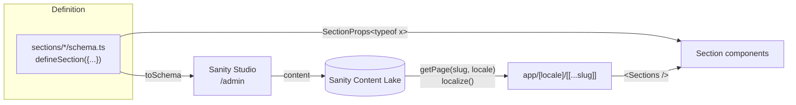

# Qalam قلم

**A schema-driven, bilingual (Arabic / English) website starter built on Next.js 16 and Sanity.**

Describe a section once as a plain object, and Qalam generates the CMS form, its validation, and fully inferred TypeScript props from it. Editors build any number of pages from those sections and edit them live, in place, in both languages.

```
Next.js 16 (App Router) · React 19 · TypeScript (strict) · Sanity v5 · Visual Editing · Tailwind v4
```

---

## The problem

In a typical Next.js + Sanity project, adding one section means keeping the same data shape in sync across many places:

| Where | What you write by hand |
|---|---|
| Sanity schema | `defineField` for every field, for every language |
| GROQ query | a projection that picks the fields again |
| TypeScript | a type that describes them a third time |
| Mapping layer | code that picks the right language and cleans each field |
| Studio config | structure, preview routes, document locations |
| Component | `data-sanity` attributes for click-to-edit |

That was the state of this project before the refactor: **one section touched 8 files, and the shape was declared 4 times.** Each copy can drift, and nothing tells you when it does.

## The solution: one definition, everything else derived

```ts
// sections/faq/schema.ts: the only place the shape exists
export const faq = defineSection({
  name: "faq",
  title: "FAQ",
  fields: {
    heading: { type: "text", required: true, max: 80 },
    items: {
      type: "list",
      min: 1,
      fields: {
        question: { type: "text", required: true },
        answer: { type: "paragraph", required: true },
      },
    },
  },
});
```

From that object:

- **The Studio form** is generated. `text` becomes one input per language side by side, `list` a sortable array, and `required` / `min` / `max` become validation applied to every language.
- **The component props** are inferred at compile time, already resolved to the visitor's language:

```tsx
// sections/faq/faq.tsx
export function Faq({ heading, items }: SectionProps<typeof faq>) {
  //                 ^ string | null   ^ Array<{ _key; question: string | null; answer: string | null }> | null
}
```

- **Registration is type-checked.** Forget to map a section to its component and the build fails.

**Adding a section is now 2 files plus 2 lines.** Changing a field is one line.

## Features

**For editors**
- **Page builder**: unlimited pages, each composed of reorderable sections (`/ar/<slug>` and `/en/<slug>`).
- **Visual Editing**: click any text on the live preview to edit it. Icons and images are click-to-edit too.
- **Side-by-side languages**: Arabic and English fields next to each other, with a full RTL / LTR layout.
- **SEO tab per page**: meta title and description with length warnings that guide without blocking publishing, a share image, `noindex`, and a canonical URL. Site-wide defaults live in a separate settings document.
- **Menu and branding from the dashboard**: internal links are written once (`/about`) and prefixed with the right language automatically.

**For developers**
- **Inferred types end to end**, with no codegen step and no hand-written content types.
- **A single CMS boundary.** Only `cms/` knows Sanity exists, so components receive plain, typed, language-resolved props.
- **Content migrations** via the Sanity CLI: dry-run by default and idempotent.
- **SEO handled at the framework level**: `<html lang dir>` per language, `hreflang` alternates, canonical URLs, Open Graph with 1200×630 crops and `og:locale`, a JSON-LD graph (Organization, WebSite, WebPage, BreadcrumbList), and a sitemap with `lastModified` that respects `noindex`.
- **Favicon, manifest and Search Console verification** managed from Site settings, with a built-in default icon.
- **Language-less URLs redirect** to the default language (`/about` → `/ar/about`) through `proxy.ts`.

## Architecture



One request, end to end:

1. `/en/about` matches `app/[locale]/[[...slug]]/page.tsx`.
2. `getPage("about", "en")` fetches the page. `localize()` walks the raw document once: `{ ar, en }` becomes the English value, images become `{ url, alt }`, slugs become strings, and internal links get the `/en` prefix.
3. `<Sections>` maps each section's `_type` to its component and spreads its fields as props.

```
app/            routes only (layouts, pages, sitemap, robots, /admin)
cms/            the only code that knows about Sanity
  define.ts     field DSL → Studio schema + TypeScript types
  documents.ts  "page" and "settings" documents
  sanity.ts     client, live fetching, localize()
  edit.ts       click-to-edit attributes for non-text elements
sections/       one folder per section: schema.ts + component + CSS
components/     site header, status pages, ui/ (Section, ButtonLink, RichText)
lib/            i18n, env, seo
migrations/     content migrations
```

## Design decisions

- **A TypeScript DSL instead of JSON.** A `.json` file would look the same but would lose literal-type inference and custom validation functions. `defineSection({...})` keeps the readability of JSON and adds both.
- **Resolve the language in one place.** Instead of a query per field, the whole document is fetched once and `localize()` picks the language recursively. That removed an entire service and mapping layer.
- **Stega first, explicit attributes second.** Sanity's stega encoding makes text click-to-edit with no markup. An explicit `edit()` helper covers the cases stega cannot (icons, images), and it renders nothing outside draft mode.
- **Warnings over errors for SEO.** Length limits warn editors without blocking a publish, because content teams need guidance, not gates.
- **`noindex` instead of `robots.txt` for hidden pages.** Disallowing a URL stops crawlers from ever seeing the `noindex`, so hidden pages stay crawlable but are marked not to be indexed.

## Getting started

```bash
npm install
cp .env.example .env.local   # Sanity project ID, dataset, read token, site URL
npm run dev
```

- Website: `http://localhost:3000/ar` and `/en`
- Dashboard: `http://localhost:3000/admin`

Seed the example pages (About, Services) and the menu:

```bash
npx sanity login
npx sanity migrations run example-pages               # dry run: prints the changes
npx sanity migrations run example-pages --no-dry-run  # applies them
```

## Adding a section

1. `sections/about/schema.ts`: `defineSection({ name: "about", title: "About", fields: {...} })`
2. `sections/about/about.tsx`: `export function About(props: SectionProps<typeof about>)`
3. Register it in `sections/index.ts` and `sections/render.tsx`.

Field types: `text`, `paragraph`, `richText`, `link` (localized); `string`, `url`, `email`, `image`, `boolean`, `slug`; `list`, `group` (or a tab with `tab: true`), `blocks`.
Options on any field: `title`, `description`, `required`, `recommended`, `min`, `max`, `validation`.

## Included sections

| Section | Shows |
|---|---|
| `hero` | status badge, headline, role, location, rich-text intro, two buttons, social links |
| `features` | heading, intro, grid of cards |
| `textImage` | heading, rich text, image on either side, button |
| `faq` | accessible accordion (`<details>`, no JavaScript) |
| `cta` | heading, text, button |

## Checks

```bash
npm run lint
npx tsc --noEmit
npx sanity schema validate
npm run build
```

## What's next

- Unit tests for `localize()` and the schema generator, which are the two pieces everything depends on
- Generic `defineDocument` collections (blog posts, projects) with listing pages
- Scheduled publishing and per-page preview links for content reviews
